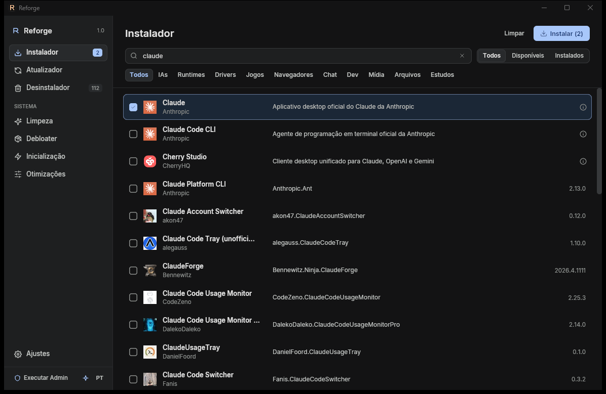
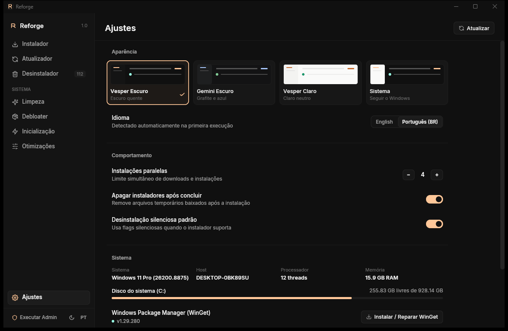

<div align="center">

# Reforge

Portable post-format toolkit for Windows 10 and 11, written in Rust.

[](https://github.com/NotBoru/Reforge/releases)
[](https://www.rust-lang.org/)
[](LICENSE)

<br/>


</div>

## Overview

Reforge bundles app installation, batch updates, uninstallation with leftover trace cleanup, temporary file cleaning, Windows debloating, startup management, and reversible system tweaks into a single portable `.exe` with no runtime dependencies.

- **Single binary**: statically linked CRT (`+crt-static`), Windows Schannel TLS, native Authenticode verification (`WinVerifyTrust`), and `wgpu` with `tiny-skia` software rendering fallback. Runs on clean Windows installs without .NET, WebView2, or VC++ Redistributables.
- **Automatic UAC elevation**: release builds embed a `requireAdministrator` manifest.
- **Persistent settings**: theme, language (auto-detected from Windows on first launch), and preferences are stored next to the executable (`reforge.json`) and in `%APPDATA%\Reforge\config.json`.
- **Themes & languages**: Vesper Dark, Gemini Dark, Vesper Light, and System themes; English and Português (BR).

## Features

| Module | Summary |
| :--- | :--- |
| **Installer** | Curated catalog of 200+ apps (browsers, runtimes, NVIDIA/AMD/peripheral software, AI tools & CLIs, Visual Studio, JetBrains IDEs, reverse engineering tools, game launchers, emulators) combined with 16,500+ WinGet packages in one searchable, auto-paginated list. Supports parallel downloads and silent install flags. |
| **Updater** | Checks installed WinGet packages for available updates and upgrades selected or individual apps in parallel. |
| **Uninstaller** | Multi-select uninstaller with native Win32 app icons, path-verified process closing before uninstall, Registry verification, and parallel leftover trace scanning (folders, files, Registry keys, shortcuts, tasks, and services). |
| **Cleaner** | Multi-threaded scan and deletion (`rayon`) for User/Windows temp files, browser caches (without touching cookies, logins, bookmarks, or history), GPU shader caches, logs, Windows Update cache, Recycle Bin, and DNS cache. |
| **Debloater** | Targeted system actions (OneDrive, Widgets, Recall/Copilot, auto-installed bloat, legacy optional features, telemetry tasks) plus Appx/UWP removal with core Windows Store/Security packages protected. |
| **Startup** | Lists Registry and Startup folder entries with extracted icons and native Task Manager enable/disable flags. |
| **Optimizations** | 26 reversible Windows tweaks across Performance, Gaming, Network, and Privacy, with post-write verification and System Restore Point support. |
| **Settings** | Theme previews, language switcher, parallel install limit, WinGet installer/repair, and portable JSON profile export/import. |

## Screenshots

<table>
  <tr>
    <td></td>
    <td></td>
  </tr>
  <tr>
    <td align="center"><sub>Installer (Gemini Dark)</sub></td>
    <td align="center"><sub>Settings (Vesper Dark)</sub></td>
  </tr>
  <tr>
    <td></td>
    <td></td>
  </tr>
  <tr>
    <td align="center"><sub>Uninstaller</sub></td>
    <td align="center"><sub>Batch uninstall confirmation</sub></td>
  </tr>
  <tr>
    <td></td>
    <td></td>
  </tr>
  <tr>
    <td align="center"><sub>Cleaner</sub></td>
    <td align="center"><sub>Optimizations</sub></td>
  </tr>
</table>

## Usage

Download `Reforge-x64-portable.exe` from [Releases](https://github.com/NotBoru/Reforge/releases) and run it directly.

Optional launch flags:

```powershell
.\Reforge-x64-portable.exe --tab=installer --theme=dark --lang=en
.\Reforge-x64-portable.exe --tab=cleaner --theme=gemini --lang=pt
```

Available tabs: `installer`, `updater`, `uninstaller`, `cleaner`, `debloater`, `startup`, `tweaks`, `settings`.

## Building from Source

Requires Rust (MSVC toolchain on Windows x64).

```powershell
git clone https://github.com/NotBoru/Reforge.git
cd Reforge
cargo test --locked
cargo build --release --locked
```

The standalone binary is written to `target\release\reforge.exe`.

## License

[MIT](LICENSE)
