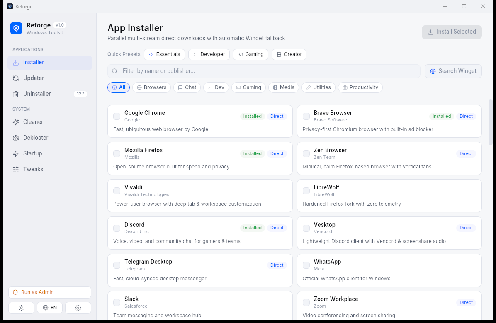
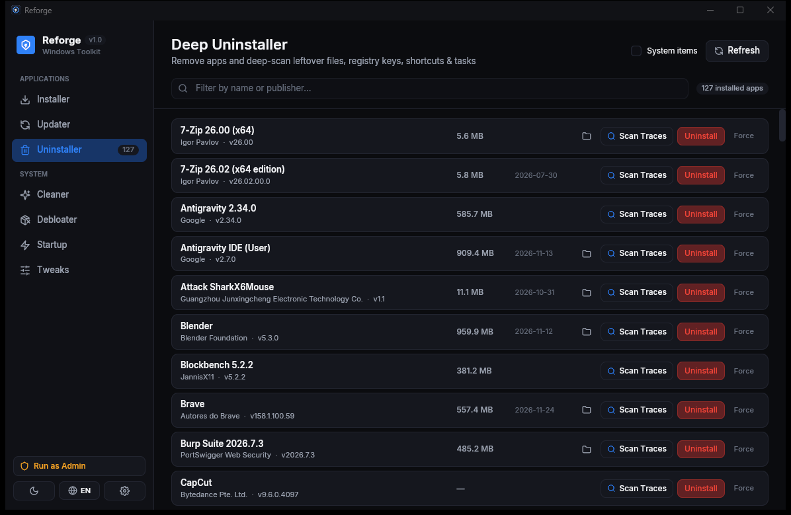
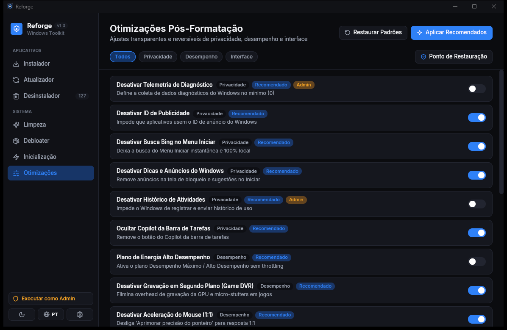

<div align="center">

# Reforge

**Ultra-fast, zero-dependency portable Windows post-format toolkit.**

Install daily apps in parallel, deep-uninstall leftover traces, update outdated software, clean gigabytes of system junk in milliseconds, debloat Windows, manage startup programs, and apply reversible post-format tweaks — all inside **one standalone native Rust executable**.

[](https://github.com/reforge-win/reforge/releases)
[](https://www.rust-lang.org/)
[](https://github.com/reforge-win/reforge/releases)
[](LICENSE)

<br/>


</div>

---

## Why Reforge?

After a clean Windows install, setting up your PC usually means juggling slow browser downloads, Ninite/Winget scripts, Revo Uninstaller, BleachBit, debloat PowerShell scripts, and scattered registry tweaks — many of which require `.NET`, `WebView2`, or `VC++ Redistributables` that aren't even installed yet.

**Reforge replaces all of them with a single 13.7 MB portable `.exe`.**

- **True Zero Dependencies**: Statically linked CRT (`+crt-static`), Windows Schannel TLS (`native-tls`), and automatic `wgpu` + `tiny-skia` software fallback. Runs immediately on freshly formatted Windows 10/11, LTSC, Tiny11, or PCs without GPU drivers, WebView2, .NET, or VC++ Redistributables.
- **Extreme Speed**: Written in native Rust with `tokio` multi-connection segmented HTTP downloads (up to 6 parallel byte-range streams per file) and `rayon` multi-threaded NTFS scanning (**100,000+ cache files scanned in ~0.5 seconds**).
- **Zero-Footprint Portable**: Writes nothing to the Windows Registry for itself, auto-cleans downloaded setup binaries, and stores optional config/profiles (`reforge.json` / `reforge-profile.json`) right beside the executable.
- **Minimal, Native Craft**: Crisp Inter typography, native Windows 10/11 DWM Dark & Light title bars, Dark / Light / System themes, and instant **English & Português (BR)** switching.

---

## Modules

| Module | What It Does |
| :--- | :--- |
| **App Installer** | Curated catalog of 55+ daily apps across 7 categories + one-click presets (*Essentials, Developer, Gaming, Creator*). Uses multi-stream direct vendor & GitHub Release installers with automatic Winget fallback, MSI lock serialization (prevents Error 1618), live Winget catalog search (10,000+ apps), and installed-app detection. |
| **App Updater** | Detects outdated software across your machine via Winget + Reforge catalog, displays clean version diffs (`old → new`), and updates apps silently in parallel. |
| **Deep Uninstaller** | Millisecond Registry scanner (HKLM 64-bit, WOW6432Node 32-bit, HKCU). Runs native silent/interactive uninstallers followed by a **Revo-style parallel Deep Trace Scanner** covering leftover directories, files, Registry keys, Start Menu/Desktop shortcuts, Scheduled Tasks, and Services — with confidence tiers (*High Match* vs *Partial*) and a strict OS protection denylist. |
| **System Cleaner** | Parallel `rayon` scanner & safe cleaner for User Temp, Windows Temp, Browser Caches (*never touches cookies, logins, bookmarks, or history*), GPU Shader Caches (NVIDIA/AMD/Intel/DirectX), Windows Logs & Crash Dumps, Windows Update & Delivery Cache, Desktop App Caches (Discord, Steam, Spotify, VS Code), Thumbnail Cache, Recycle Bin, and Prefetch/DNS. |
| **Windows Debloater** | Scans installed UWP/Appx packages and cleanly removes both user and provisioned bloatware while strictly protecting Microsoft Store, Winget, Calculator, Photos, Terminal, and Windows Security. |
| **Startup Manager** | Reads HKCU/HKLM Run keys and Startup folders directly in `<10 ms`. Toggles items using Windows Task Manager's native `StartupApproved` flags so changes stay 100% synced and lossless. |
| **Post-Format Tweaks** | 18 transparent, reversible privacy, performance, and UI tweaks (Telemetry, Bing Start Search, High/Ultimate Performance Power Plan, Game DVR, 1:1 Raw Mouse Input, Startup Delay, Classic Win11 Context Menu, File Extensions, End Task in Taskbar) with live state detection, one-click Restore Point creation, and *Restore Defaults*. |
| **Portable Profiles & Winget Bootstrapper** | Export/import your app selections and tweaks to `reforge-profile.json` to replicate your exact setup on any PC. Includes a one-click Winget installer/repairer straight from Microsoft's official GitHub Releases. |

---

## Screenshots

<table>
  <tr>
    <td></td>
    <td></td>
  </tr>
  <tr>
    <td align="center"><sub><b>Installer (Light Mode)</b> — Adaptive DWM titlebar & live installed detection</sub></td>
    <td align="center"><sub><b>System Cleaner</b> — 103,992 files (15.54 GB) scanned in 581 ms</sub></td>
  </tr>
  <tr>
    <td></td>
    <td></td>
  </tr>
  <tr>
    <td align="center"><sub><b>Deep Uninstaller</b> — Instant registry inventory + Revo-style leftover trace scanner</sub></td>
    <td align="center"><sub><b>Post-Format Tweaks (PT-BR)</b> — Live registry detection & one-click Restore Point</sub></td>
  </tr>
</table>

---

## Zero-Dependency Verification

Inspecting the release PE import table of `reforge.exe` confirms **zero non-OS runtime dependencies**:

```text
Binary size:   ~13.7 MB (single standalone .exe, embedded Inter fonts + vector icons)
CRT linking:   Static (+crt-static) — no vcruntime140.dll / msvcp140.dll
TLS backend:   Windows Schannel (secur32.dll / crypt32.dll) — no OpenSSL
Renderer:      wgpu (DX12/Vulkan/DX11) with automatic tiny-skia CPU fallback — no WebView2
```

---

## Quick Start

### Download Portable Binary
Download the latest `Reforge-x64-portable.exe` from [GitHub Releases](https://github.com/reforge-win/reforge/releases) and double-click to run — no installation required.

### Optional CLI Launch Flags
```powershell
# Open directly to a specific module, theme, or language
.\Reforge-x64-portable.exe --tab=cleaner --theme=dark --lang=en
.\Reforge-x64-portable.exe --tab=tweaks --theme=light --lang=pt
```

Supported tabs: `installer`, `updater`, `uninstaller`, `cleaner`, `debloater`, `startup`, `tweaks`, `settings`.

---

## Build from Source

### Prerequisites
- Windows 10 / 11 (x64)
- [Rust](https://rustup.rs/) 1.88+ (`x86_64-pc-windows-msvc` target)
- Visual Studio Build Tools (MSVC C++ linker)

### Compile & Test
```powershell
git clone https://github.com/reforge-win/reforge.git
cd reforge

# Run unit & live Windows safety tests
cargo test

# Build optimized standalone portable binary (target\release\reforge.exe)
cargo build --release
```

---

## Safety Philosophy

- **No silent destructive changes**: Every leftover trace in Deep Uninstaller is categorized (*High Match* vs *Partial*) and previewed with checkboxes before deletion. Generic vendor & OS paths (`Windows`, `System32`, `Program Files`, `Microsoft`, `Google`, etc.) are hardcoded on a strict protection denylist.
- **Browser data untouched**: System Cleaner removes only cache/shader directories — never cookies, saved passwords, sessions, bookmarks, or history.
- **Reversible tweaks**: Every tweak detects its current Windows Registry/Power state live and can be toggled off or reverted with *Restore Defaults*.
- **No hidden elevation**: Launches instantly as standard user for safe scanning and inspection, with a one-click **Run as Admin** button when elevated operations are needed.

---

## Contributing

Contributions — new curated catalog apps, direct installer endpoints, safer bloatware definitions, or localization improvements — are very welcome! See [CONTRIBUTING.md](CONTRIBUTING.md).

## License

Released under the [MIT License](LICENSE).
