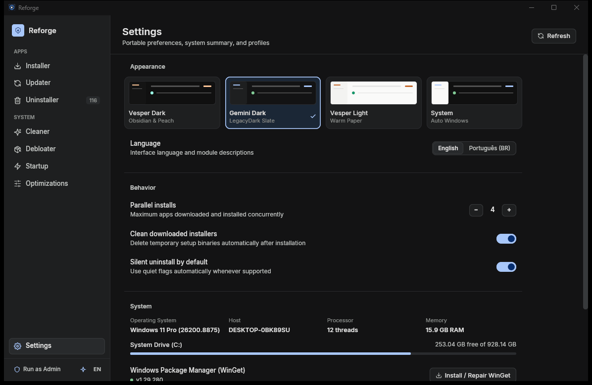
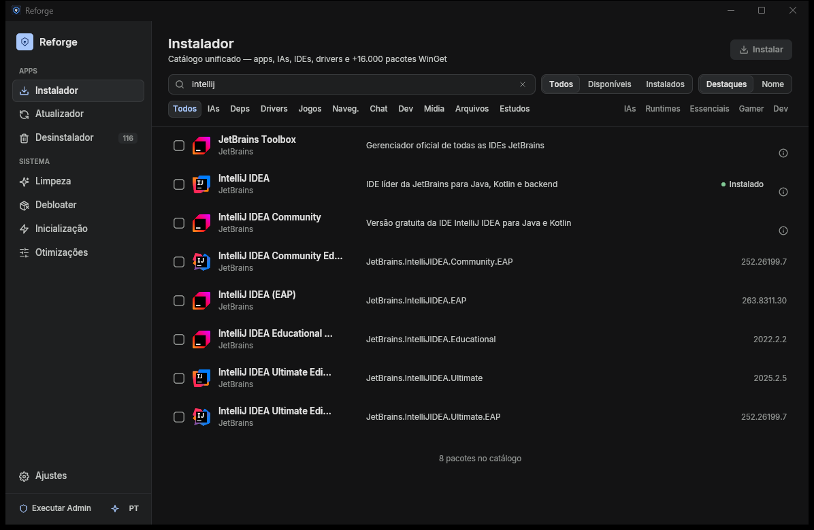
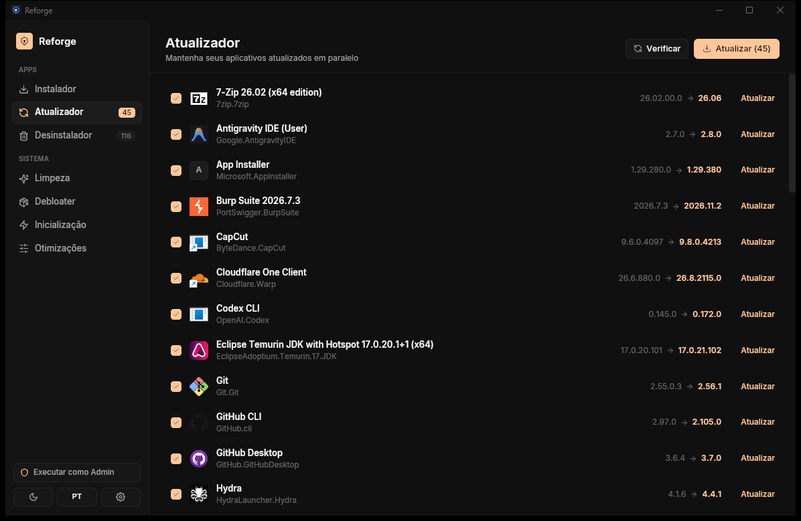
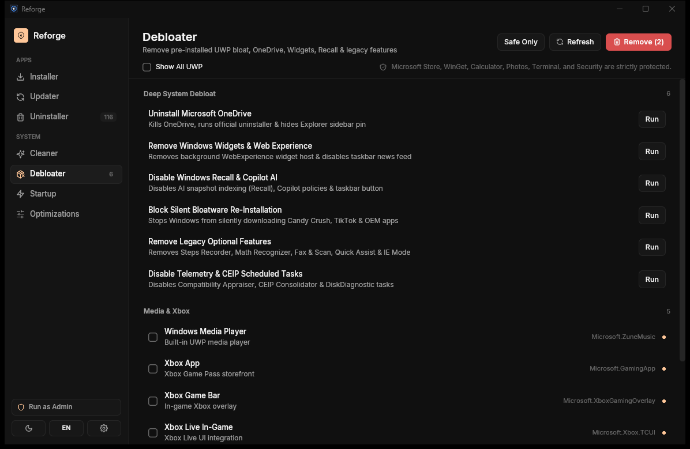
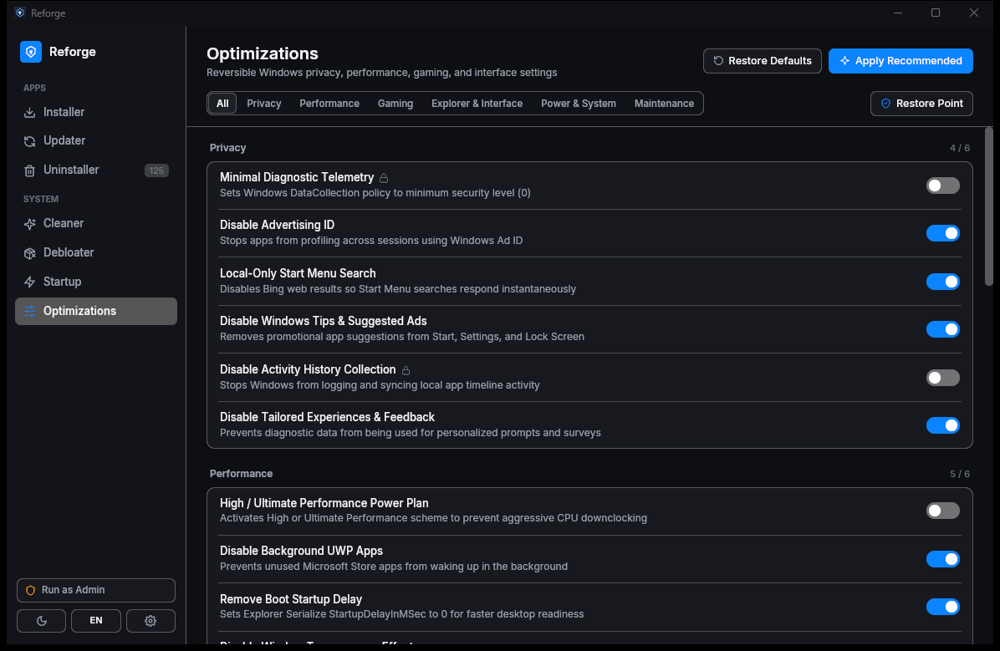

<div align="center">

# Reforge

**Ultra-fast, zero-dependency portable Windows post-format toolkit.**

Install **190+ curated apps, AI tools, JetBrains IDEs, peripheral drivers, runtimes & gaming launchers** seamlessly unified with **16,500+ live Microsoft WinGet packages** (infinite scroll & instant as-you-type search), safely close & deep-uninstall applications with leftover trace cleanup, update outdated software, wipe temp & cache junk across all CPU cores, deep-debloat Windows, manage startup programs, and apply **26 high-impact verified optimizations** — all inside **one standalone native Rust executable**.

[](https://github.com/NotBoru/Reforge/releases)
[](https://www.rust-lang.org/)
[](https://github.com/NotBoru/Reforge/releases)
[](LICENSE)

<br/>


</div>

---

## Why Reforge?

After a clean Windows install, setting up your PC usually means juggling slow browser downloads, scattered runtime links, Revo Uninstaller, disk cleaners, debloat scripts, and registry tweaks — many of which require `.NET`, `WebView2`, or `VC++ Redistributables` that aren't installed yet.

**Reforge replaces all of them with a single ~15 MB portable `.exe` with embedded UAC Administrator elevation.**

- **True Zero Dependencies**: Statically linked CRT (`+crt-static`), Windows Schannel TLS (`native-tls`), native `WinVerifyTrust` Authenticode checks, and `wgpu` + `tiny-skia` software fallback. Runs immediately on freshly formatted Windows 10/11, LTSC, Tiny11, or PCs without GPU drivers, WebView2, .NET, or VC++ Redistributables.
- **Vesper & Gemini LegacyDark Themes + Smooth Hover Motion**: Switch effortlessly between **Vesper Dark** (`#101010` obsidian / `#FFC799` peach), **Gemini LegacyDark** (`#131314` slate / `#A8C7FA` periwinkle blue), **Vesper Light**, and **System** with live theme preview cards, borderless lists, zero harsh row separators, 60/120fps animated hover transitions, OS reduced-motion support, native DWM titlebars, and instant **English & Português (BR)** switching.
- **Real Application Logos Everywhere**: Extracts real native Win32 RGBA icons directly from installed executables, `DisplayIcon` registry metadata, Squirrel launchers, and Start Menu shortcuts (`ExtractIconExW` / `SHGetFileInfoW` / `GetDIBits`), paired with disk-cached streaming logos for catalog and WinGet apps.
- **Extreme Multi-Core Speed**: Persistent HTTP/2 pooling, 6-stream byte-range parallel downloads, automatic retries, cancellation, and `rayon` multi-core scanning **and** multi-core parallel deletion for massive `%TEMP%` directories.

---

## Modules

| Module | Capabilities |
| :--- | :--- |
| **Installer** | **Unified infinite-scroll catalog** combining **190+ curated flagship apps** with **16,500+ live Microsoft WinGet packages** in a single seamless list — instant as-you-type search with zero extra clicks. Includes AI apps & CLIs (*Claude Desktop, Claude Code, ChatGPT, Codex CLI, Gemini, Antigravity, OpenCode Desktop & CLI, Cursor, Windsurf, Ollama, LM Studio, ComfyUI*), JetBrains IDEs (*IntelliJ IDEA, PyCharm, WebStorm, CLion, Rider, RustRover, DataGrip*), peripheral & driver suites (*Logitech G HUB / Options+, Razer Synapse 4, SteelSeries GG, Corsair iCUE 5, SignalRGB, G-Helper, DDU, NVCleanstall, Voicemeeter*), runtimes (*VC++ 2010–2022, DirectX, .NET 6/8/9, Java 8/17/21*), gaming (*Steam, Hydra Launcher, Lunar Client, CheatBreaker, Badlion, Minecraft Launcher*), creative/3D, file managers & study tools. |
| **Updater** | Detects outdated software across your PC with real app icons and typographic version diffs (`old → new`), updating selected or individual apps silently in parallel with automatic failure retries. |
| **Uninstaller** | Multi-select bulk uninstaller with real native Win32 app logos, sorting (*Name / Size / Date*), app details inspector, and a full verified removal lifecycle: strictly path-verified running process detection (protecting all Windows system processes), graceful `WM_CLOSE` shutdown, native MSI/EXE uninstallation, post-uninstall Registry verification, and **Revo-style parallel Deep Trace Scanner** (folders, files, Registry keys, shortcuts, scheduled tasks, services). |
| **Cleaner** | Proportional Vesper storage breakdown bar + **multi-core parallel scanning & deletion** (`rayon`) for User Temp, Windows Temp, Browser Caches (*never touches cookies, logins, bookmarks, or history*), GPU Shader Caches (NVIDIA/AMD/Intel/DirectX), System Logs & Crash Dumps, Windows Update Cache, Desktop App Caches, Thumbnails, Recycle Bin, and Prefetch/DNS. |
| **Debloater** | **6 Deep System Debloat actions** (*Uninstall OneDrive, Remove Widgets & WebExperience, Disable Windows Recall & Copilot AI, Block Silent Auto-Installed Bloatware, Remove Legacy Optional Features, Disable Telemetry Scheduled Tasks*) + **73+ known UWP bloatware rules** + **Show All Removable UWP** mode, while strictly protecting Microsoft Store, WinGet, Calculator, Photos, Terminal, and Windows Security. |
| **Startup** | Instant `<10 ms` Registry & Startup folder inventory with real extracted app logos (including Squirrel `--processStart` resolution) and native Task Manager `StartupApproved` toggle flags. |
| **Optimizations** | **26 proven, high-impact reversible Windows optimizations** (zero fluff) across 4 focused categories (*Performance & FPS, Gaming & Latency, Network & Ping, Privacy & Essentials*): Ultimate Power Plan, HAGS, Win32PrioritySeparation `0x26`, Unpark CPU Cores, Power Throttling, Memory Compression, SysMain, Game DVR, Game Mode, Gaming MMCSS/GPU Priority, Fullscreen Optimizations, 1:1 Raw Mouse, Network Throttling, Nagle (`TCPNoDelay`), Cloudflare `1.1.1.1` DNS, Telemetry, Background UWP Apps, Local Start Menu, Classic Win11 Context Menu, Taskbar End Task, and more — all post-verified with one-click Restore Point & rollback. |
| **Settings & Portable Profiles** | System overview, Vesper Dark / Vesper Light / System theme, EN / PT-BR language, concurrency control, one-click official WinGet bootstrapper, and portable JSON profile export/import (`reforge-profile.json`). |

---

## Screenshots

<table>
  <tr>
    <td></td>
    <td></td>
  </tr>
  <tr>
    <td align="center"><sub><b>Gemini LegacyDark Theme</b> — Unified 16,500+ infinite-scroll catalog with AI, IDEs, Drivers &amp; Games</sub></td>
    <td align="center"><sub><b>Refactored Settings</b> — Visual live theme swatch cards (Vesper Dark, Gemini Dark, Vesper Light, System)</sub></td>
  </tr>
  <tr>
    <td></td>
    <td></td>
  </tr>
  <tr>
    <td align="center"><sub><b>Instant Unified Search</b> — Typing searches curated apps + 16,500+ WinGet packages seamlessly</sub></td>
    <td align="center"><sub><b>Updater</b> — Borderless Vesper rows, real app logos &amp; clean typographic version diffs</sub></td>
  </tr>
  <tr>
    <td></td>
    <td></td>
  </tr>
  <tr>
    <td align="center"><sub><b>Uninstaller</b> — Real Win32 icons, multi-select table &amp; single toolbar CTA</sub></td>
    <td align="center"><sub><b>Uninstall Lifecycle Sheet</b> — Graceful process closing &amp; post-uninstall trace scan</sub></td>
  </tr>
  <tr>
    <td></td>
    <td></td>
  </tr>
  <tr>
    <td align="center"><sub><b>Debloater</b> — Deep System tools (OneDrive, Widgets, Recall, Copilot) + 73+ UWP rules &amp; Show All</sub></td>
    <td align="center"><sub><b>Optimizations</b> — 26 high-impact Performance, Gaming, Network &amp; Essential tweaks</sub></td>
  </tr>
  <tr>
    <td></td>
    <td></td>
  </tr>
  <tr>
    <td align="center"><sub><b>Multi-Core Cleaner</b> — Parallel NTFS scan &amp; deletion with Vesper breakdown bar</sub></td>
    <td align="center"><sub><b>Vesper Light Mode</b> — Warm neutral canvas with adaptive DWM titlebar</sub></td>
  </tr>
</table>

---

## Zero-Dependency & Admin Elevation Verification

Inspecting the release PE binary of `reforge.exe` confirms **zero non-OS runtime dependencies** and automatic UAC elevation:

```text
Binary size:   ~15.0 MB (single standalone .exe, embedded Inter fonts + icons + pure-Rust codecs)
UAC Manifest:  requireAdministrator (embedded automatically on release builds)
CRT linking:   Static (+crt-static) — no vcruntime140.dll / msvcp140.dll
TLS & Trust:   Windows Schannel + WinVerifyTrust — no OpenSSL
Renderer:      wgpu (DX12/Vulkan/DX11) with automatic tiny-skia CPU fallback — no WebView2
```

---

## Quick Start

Download `Reforge-x64-portable.exe` from [GitHub Releases](https://github.com/NotBoru/Reforge/releases) and run directly — no installer or dependencies required.

### Optional CLI Launch Flags
```powershell
.\Reforge-x64-portable.exe --tab=cleaner --theme=dark --lang=en
.\Reforge-x64-portable.exe --tab=installer --theme=gemini --lang=pt
.\Reforge-x64-portable.exe --tab=tweaks --theme=light --lang=pt
```

Supported tabs: `installer`, `updater`, `uninstaller`, `cleaner`, `debloater`, `startup`, `tweaks`, `settings`.

---

## Build from Source

```powershell
git clone https://github.com/NotBoru/Reforge.git
cd reforge

cargo test --locked
cargo build --release
```

Output binary: `target\release\reforge.exe`.

---

## Safety Philosophy

- **Strict process protection**: Graceful shutdown only targets processes whose full executable image path is strictly verified inside the selected app's installation directory. Critical Windows processes (`explorer.exe`, `svchost.exe`, `csrss.exe`, `dwm.exe`, `C:\Windows\*`, etc.) are hardcoded untouchable.
- **Honest verification**: Uninstallers verify whether the Registry entry was actually removed afterward; system optimizations re-read Windows state after writing to confirm changes persisted.
- **Browser data untouched**: Cleaner targets cache and shader directories only — never cookies, saved passwords, bookmarks, or browsing history.
- **Protected Windows Core**: Debloater strictly blocks removal of Microsoft Store, WinGet, Calculator, Photos, Terminal, and Windows Security even in *Show All UWP* mode.
- **No silent destructive bulk actions**: Bulk uninstallation, debloating, and bulk optimization presets always present a clear confirmation sheet first.

## License

Released under the [MIT License](LICENSE).
