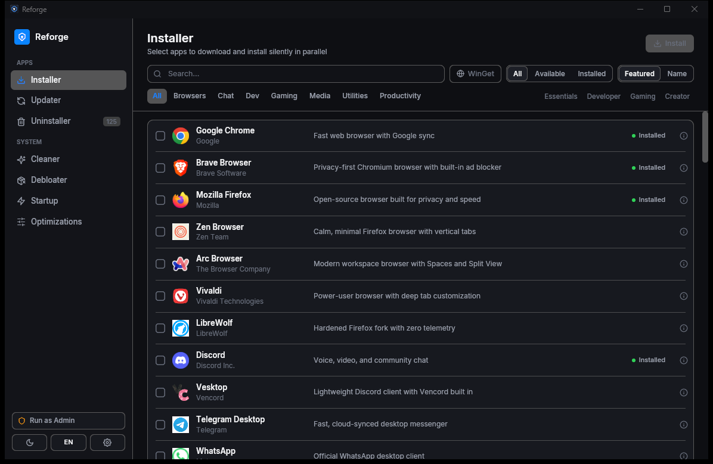

# Reforge

Portable post-format utility for Windows 10 and 11, written in Rust.



## What it does

- **Installer** — install apps, runtimes, drivers, and WinGet packages in parallel.
- **Updater** — check and update installed packages.
- **Uninstaller** — batch uninstall programs and remove leftover files, registry keys, shortcuts, tasks, and services.
- **Cleaner** — clear temp folders, shader caches, logs, and browser caches without touching cookies or logins.
- **Debloater** — remove pre-installed Windows apps, OneDrive, Widgets, and telemetry tasks.
- **Startup** — manage Windows startup entries.
- **Optimizations** — reversible performance, gaming, network, and privacy settings.

Single standalone `.exe` with no external runtime dependencies. Supports English and Português (BR).

## Download

Get `Reforge-x64-portable.exe` from [Releases](https://github.com/NotBoru/Reforge/releases) and run it directly.

## Build from source

Requires the Rust `x86_64-pc-windows-msvc` toolchain.

```powershell
cargo build --release --locked
```

## License

[MIT](LICENSE)
