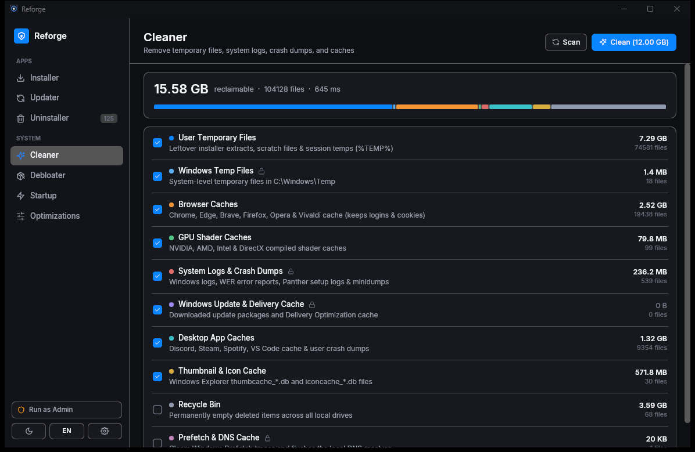
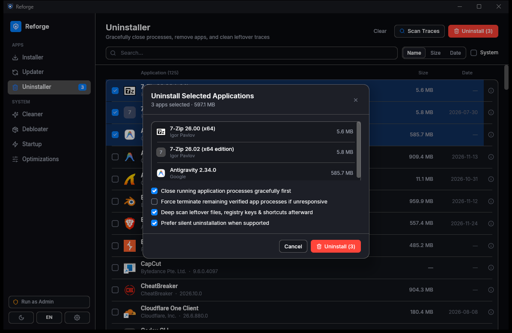
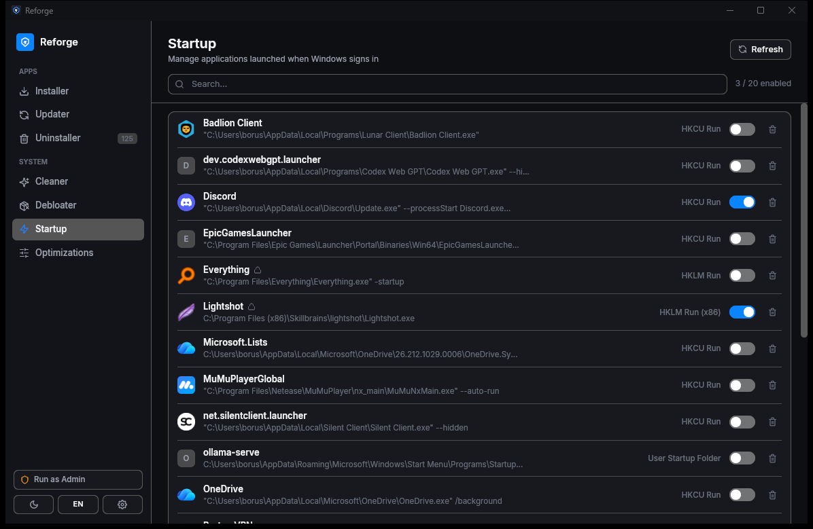

<div align="center">

# Reforge

**Ultra-fast, zero-dependency portable Windows post-format toolkit.**

Install daily apps in parallel, safely close & deep-uninstall applications with leftover trace cleanup, update outdated software, clean gigabytes of system junk in milliseconds, debloat Windows, manage startup programs, and apply 30 verified reversible optimizations — all inside **one standalone native Rust executable**.

[](https://github.com/reforge-win/reforge/releases)
[](https://www.rust-lang.org/)
[](https://github.com/reforge-win/reforge/releases)
[](LICENSE)

<br/>


</div>

---

## Why Reforge?

After a clean Windows install, setting up your PC usually means juggling slow browser downloads, package scripts, Revo Uninstaller, disk cleaners, debloat PowerShell scripts, and scattered registry tweaks — many of which require `.NET`, `WebView2`, or `VC++ Redistributables` that aren't installed yet.

**Reforge replaces all of them with a single ~14.9 MB portable `.exe`.**

- **True Zero Dependencies**: Statically linked CRT (`+crt-static`), Windows Schannel TLS (`native-tls`), native `WinVerifyTrust` Authenticode checks, and `wgpu` + `tiny-skia` software fallback. Runs immediately on freshly formatted Windows 10/11, LTSC, Tiny11, or PCs without GPU drivers, WebView2, .NET, or VC++ Redistributables.
- **Real Application Logos Everywhere**: Extracts real native Win32 RGBA icons directly from installed executables, `DisplayIcon` registry metadata, Squirrel launchers, and Start Menu shortcuts (`ExtractIconExW` / `SHGetFileInfoW` / `GetDIBits`), paired with disk-cached streaming logos for catalog apps.
- **Extreme Speed**: Native Rust with persistent HTTP/2 pooling, 6-stream byte-range parallel downloads, automatic retries, cancellation support, and `rayon` multi-threaded NTFS scanning (**100,000+ cache files scanned in ~0.6 seconds**).
- **Refined Desktop Craft**: Unified Apple-inspired surface-layer hierarchy, hairline inset grouped lists, centered confirmation sheets, OS reduced-motion support (`SPI_GETCLIENTAREAANIMATION`), native Windows 10/11 DWM Dark & Light title bars, and instant **English & Português (BR)** switching.

---

## Modules

| Module | Capabilities |
| :--- | :--- |
| **Installer** | 73 curated daily apps across 7 categories + one-click presets (*Essentials, Developer, Gaming, Creator*) + live WinGet catalog search across thousands of packages. Supports filtering (*All / Available / Installed*), sorting, real app logos, app details modal, multi-stream direct downloads with Authenticode verification, automatic retries, cancellation, MSI serialization, and WinGet fallback. |
| **Updater** | Shares the unified list & real app icon system. Detects outdated software across your PC, displays clean typographic version diffs (`old → new`), updates selected or individual apps silently in parallel, and retries failed updates cleanly. |
| **Uninstaller** | Multi-select bulk uninstaller with real native Win32 app logos, sorting (*Name / Size / Date*), app details inspector, and a full verified removal lifecycle: strictly path-verified running process detection (protecting all Windows system processes), graceful `WM_CLOSE` shutdown, native MSI/EXE uninstallation, post-uninstall Registry verification, and **Revo-style parallel Deep Trace Scanner** (folders, files, Registry keys, shortcuts, scheduled tasks, services). |
| **Cleaner** | CleanMyMac-style proportional storage breakdown bar + parallel `rayon` scanner for User Temp, Windows Temp, Browser Caches (*never touches cookies, logins, bookmarks, or history*), GPU Shader Caches (NVIDIA/AMD/Intel/DirectX), System Logs & Crash Dumps, Windows Update Cache, Desktop App Caches, Thumbnails, Recycle Bin, and Prefetch/DNS. |
| **Debloater** | Categorized UWP/Appx bloatware inspector with confirmation sheet. Removes user and provisioned packages while strictly protecting Microsoft Store, WinGet, Calculator, Photos, Terminal, and Windows Security. |
| **Startup** | Instant `<10 ms` Registry & Startup folder inventory with real extracted app logos (including Squirrel `--processStart` resolution) and native Task Manager `StartupApproved` toggle flags. |
| **Optimizations** | **30 reversible, post-verified Windows optimizations** organized cleanly into 6 macOS-style sections (*Privacy, Performance, Gaming, Explorer & Interface, Power & System, Maintenance*) with live state detection, one-click Restore Point creation, and confirmation modal with rollback. |
| **Settings & Portable Profiles** | System overview, Dark/Light/System theme, EN/PT-BR language, concurrency control, one-click official WinGet bootstrapper, and portable JSON profile export/import (`reforge-profile.json`). |

---

## Screenshots

<table>
  <tr>
    <td></td>
    <td></td>
  </tr>
  <tr>
    <td align="center"><sub><b>Installer (Light Mode)</b> — Real logos, segmented filters & adaptive DWM titlebar</sub></td>
    <td align="center"><sub><b>Cleaner</b> — 104,128 files (15.58 GB) scanned in 645 ms with breakdown bar</sub></td>
  </tr>
  <tr>
    <td></td>
    <td></td>
  </tr>
  <tr>
    <td align="center"><sub><b>Uninstaller</b> — Real Win32 icons, multi-select table & single toolbar CTA</sub></td>
    <td align="center"><sub><b>Uninstall Lifecycle Sheet</b> — Graceful process closing & post-uninstall trace scan</sub></td>
  </tr>
  <tr>
    <td></td>
    <td></td>
  </tr>
  <tr>
    <td align="center"><sub><b>Optimizations</b> — 30 verified reversible tweaks grouped cleanly across 6 categories</sub></td>
    <td align="center"><sub><b>Startup Manager</b> — Native <code>StartupApproved</code> flags with extracted app logos</sub></td>
  </tr>
</table>

---

## Zero-Dependency Verification

Inspecting the release PE import table of `reforge.exe` confirms **zero non-OS runtime dependencies**:

```text
Binary size:   ~14.9 MB (single standalone .exe, embedded Inter fonts + icons + pure-Rust codecs)
CRT linking:   Static (+crt-static) — no vcruntime140.dll / msvcp140.dll
TLS & Trust:   Windows Schannel + WinVerifyTrust — no OpenSSL
Renderer:      wgpu (DX12/Vulkan/DX11) with automatic tiny-skia CPU fallback — no WebView2
```

---

## Quick Start

Download `Reforge-x64-portable.exe` from [GitHub Releases](https://github.com/reforge-win/reforge/releases) and run directly — no installer required.

### Optional CLI Launch Flags
```powershell
.\Reforge-x64-portable.exe --tab=cleaner --theme=dark --lang=en
.\Reforge-x64-portable.exe --tab=tweaks --theme=light --lang=pt
```

Supported tabs: `installer`, `updater`, `uninstaller`, `cleaner`, `debloater`, `startup`, `tweaks`, `settings`.

---

## Build from Source

```powershell
git clone https://github.com/reforge-win/reforge.git
cd reforge

cargo test --locked
cargo build --release
```

Output binary: `target\release\reforge.exe`.

---

## Safety Philosophy

- **Strict process protection**: Graceful shutdown only targets processes whose full executable image path is strictly verified inside the selected app's installation directory. Critical Windows processes (`explorer.exe`, `svchost.exe`, `csrss.exe`, `dwm.exe`, `C:\Windows\*`, etc.) are hardcoded untouchable.
- **Honest verification**: Uninstallers verify whether the Registry entry was actually removed afterward; system optimizations re-read Windows state after writing to confirm changes persisted.
- **Browser data untouched**: Cleaner targets cache and shader directories only — never cookies, saved passwords, bookmarks, or browsing history.
- **No silent destructive bulk actions**: Bulk uninstallation, debloating, and bulk optimization presets always present a clear confirmation sheet first.

## License

Released under the [MIT License](LICENSE).
